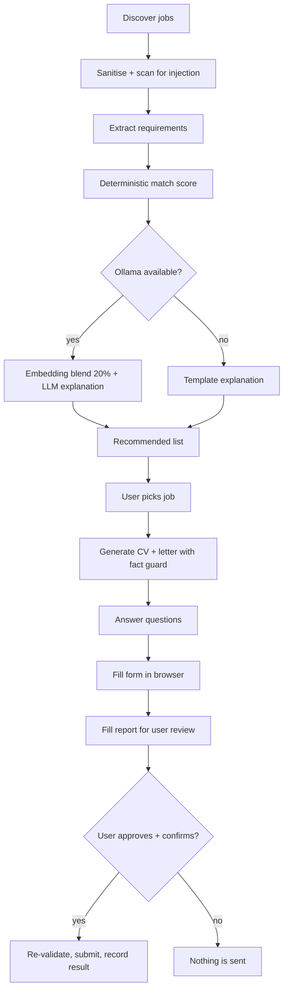

# AI Agent Workflow

## Matching
`matching/extract.py` pulls required vs preferred skills and years from the job text using a skill taxonomy; `engine.compute_match` scores coverage of requirements against your profile, location/work-mode/salary preferences, and seniority. Embeddings (if the embedding model is installed) contribute at most 20%. The LLM writes the explanation only; it cannot change the score.

## Generation with a fact guard
CV and letter generators build content from profile data (ranking required skills first). When an LLM drafts text, `validate_*` rejects output containing skills, numbers or years not supported by the profile and falls back to a deterministic template. Nothing in the output can claim experience you did not enter.

## Application questions
1. Sensitive/legal/eligibility/demographic (work authorization, disability, ethnicity, criminal record, salary demands…) → **`needs_user`**: never answered automatically.
2. Direct profile facts (name, email, links, notice period…) → filled deterministically.
3. Fuzzy match to a previously **approved** answer → reused.
4. Otherwise a template/LLM draft marked *needs approval*. Unrecognised questions get no draft.

## Prompt-injection posture
All web/job text is wrapped in `UNTRUSTED_DATA` blocks (`wrap_untrusted`; any delimiter text inside the content is neutralised so it cannot close the block early), scanned for instruction-like patterns (flags shown to you), and the system prompt tells the model to treat it as data. Because decisions (scores, approvals, submission) are deterministic, a hostile job ad cannot trigger actions.

## Failure behaviour
Ollama down/disabled/model missing → `AIUnavailableError` → fallbacks plus a clear message (`ollama pull qwen3:4b`).
