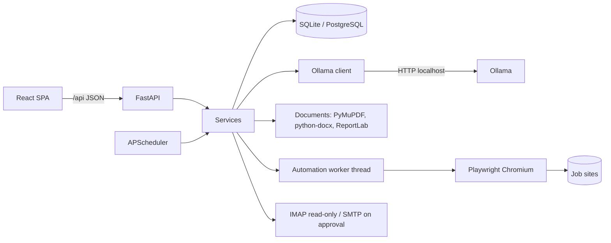
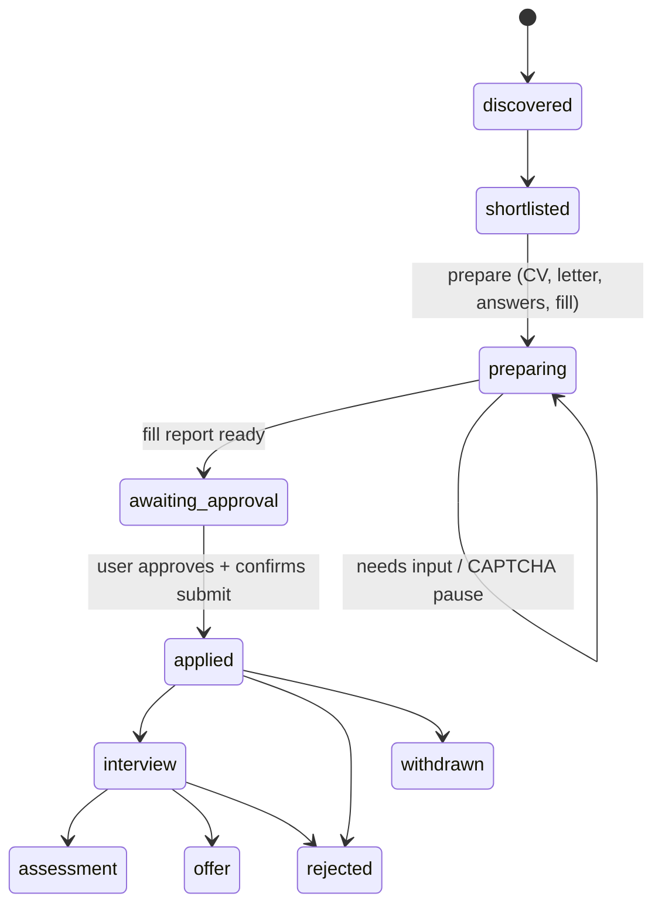

# Project Blueprint

## 1. Goal
A local-first agent that automates the *tedious* parts of job hunting (discovery, scoring, tailoring, form filling, tracking) while keeping the human as the final decision-maker.

## 2. Requirements → modules
| Module | Capability | Backend package |
|---|---|---|
| A Profile | Structured profile, CV import (PDF/DOCX), verified facts | `services/profile_service`, `documents/parsing` |
| B Discovery | Greenhouse, Lever, RSS, career pages, manual URL/text; dedupe | `jobs/` |
| C Matching | Deterministic skill/requirement scoring + optional embeddings | `matching/` |
| D CV generator | Tailored CVs (PDF/DOCX) with fact guard | `documents/cv`, `documents/render` |
| E Cover letters | Templates + LLM drafts with fact guard | `documents/letters` |
| F Q&A | Profile facts, approved-answer reuse, drafts needing approval | `applications/answers` |
| G Form filling | Detect → map → fill multi-page forms | `automation/` |
| H Submission | Gated, single-use approval, re-validation | `automation/runner`, `applications/service` |
| I Tracking | Status pipeline, events, follow-ups, duplicates | `applications/service` |
| J Interview | Prep notes, interview records | `services/interview_service` |
| K Email | Read-only IMAP, classified inbox, approved SMTP drafts | `notifications/email` |
| L Scheduler | Cron schedules, daily report, retention | `tasks/scheduler` |

## 3. Stack decisions (and why)
- **FastAPI + Pydantic**: typed validation at the boundary; auto OpenAPI docs at `/docs`.
- **SQLAlchemy + Alembic, SQLite default**: zero-install persistence; naming conventions and batch migrations keep the schema PostgreSQL-compatible (set `JOBAGENT_DATABASE_URL`, install `psycopg[binary]`).
- **Modular monolith**: one process, clear packages. A single user on one machine gains nothing from microservices.
- **Ollama**: the only AI dependency; models are swappable in AI Settings.
- **Deterministic core, LLM at the edges**: scores and approvals never depend on model output, which also makes prompt injection low-impact.
- **Playwright (headed, persistent profile)**: you can log in, solve CAPTCHAs and watch the agent; a dedicated worker thread owns the sync API.
- **React + TanStack Query + RHF + Zod**: server state caching, forms with schema validation, accessible Radix dialogs.

## 4. System diagram

## 5. Application lifecycle

## 6. Delivery phases
1. Foundation (config, security, DB, migrations) 2. Profile 3. Discovery + matching 4. Generation 5. Automation + submission 6. Tracking, email, scheduler 7. Frontend 8. Tests, docs, packaging. See `DEVELOPMENT_PROGRESS.md`.
